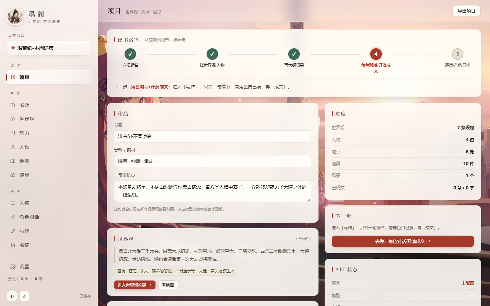
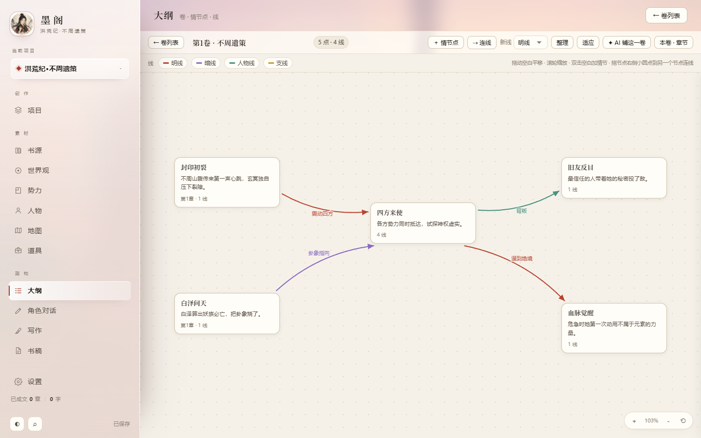
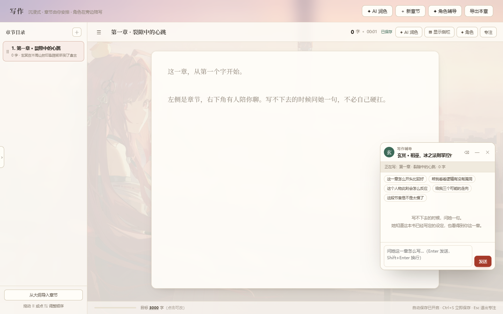

# 墨阁 · 小说工坊

> 本地优先的 AI 长篇小说写作台 —— 人物锁性格、地图连场景、大纲搭结构，
> 写作时只给一句情节，角色自己演，最后成文。


给自己写小说用的本地工具。数据全部保存在你自己电脑上，API Key 只存在本地、
由本地服务转发，不上传任何服务器。

## 界面







## 特性

**创作**

- **人物性格锁** —— 把性格、说话方式、秘密、知识边界写死，AI 不跑偏；文件夹式分组管理，双向合并的人物关系网
- **势力** —— 分类、所属地（引用地图地名）、成员、势力关系图，连线可拖拽建立
- **世界观 / 编年** —— 世界底色条目，AI 只在原文后面补细节、逐字保留你写的东西
- **大纲 · 情节画布** —— 每卷一块画布，双击落点就是情节，自由连线分**明线 / 暗线 / 人物线 / 支线**，卡片上直接编辑，AI 可按你的人物设定铺一卷
- **书稿** —— 章节汇编、通读批注、出版前一致性检查

**写作**

- **角色对话** —— 导演 → 角色 → 叙事者三段流水线：只写一句「这场戏要发生什么」，角色按性格对戏，最后成文；也可作为作者直接访谈人物
- **沉浸式写作页** —— 章节管理、字数目标、专注模式、可拖动的角色辅导小窗
- **AI 润色** —— 想法成章 / 扩写选段 / 保真润色 / 只提建议，四种模式，前后对照，一键采用
- **全局 AI 撤销** —— 任何 AI 生成的结果（含世界观扩充、情节铺卷）都可整书回退

**素材**

- **书源导入** —— 把一部已有小说变成可续写的项目：自动提取文风档案、人物（含分类与人物卡）、地图与物品归属
- **双层地图** —— 外域大地图 + 城镇内部地图，地点 / 痕迹 / 道具管理，可生成建筑立面图（程序绘图零成本）或 AI 写实图
- **多套 API 配置** —— 保存多套 baseUrl / Key / 模型，按场景切换：润色给文笔最好的，角色对话给便宜快的，图像给会画图的

## 快速开始

需要 [Node.js 18+](https://nodejs.org)（零 npm 依赖，装好 Node 即可）。

```bash
git clone https://github.com/Han7hy/moge-novel-workshop.git
cd moge-novel-workshop
node server.js
```

浏览器会自动打开 `http://127.0.0.1:7788`。

- Windows：也可以直接双击 `启动.bat`
- macOS / Linux：`npm start` 或 `node server.js`
- 服务器 / 无界面环境：`NO_OPEN=1 node server.js`（不自动开浏览器），端口用 `PORT=xxxx` 覆盖

### 第一次用

1. 进「设置」，点「＋ 新增一套」添加一个 OpenAI 兼容接口（内置 DeepSeek / Kimi /
   智谱 / 通义 / OpenAI / Ollama 预设），填 API Key，点「测试连接」
2. 想续写已有小说：进「书源」把 .txt 拖进去，点「开始分析」
3. 从零开始：进「项目」写世界观和文风 → 「人物」锁性格 → 「地图」建场景 → 「大纲」搭结构 → 「写作」开演

> 所有数据保存在 `data/` 目录（已被 .gitignore 排除，不会误提交）。
> 换电脑：设置页「导出项目 JSON」→ 新机器「导入项目」。

## 目录结构

```
server.js            零依赖本地服务：静态托管 + API 代理（对话/图像）
启动.bat             Windows 一键启动
package.json         npm start 入口
public/
  index.html         入口页
  css/style.css      全部样式（亮/暗双主题）
  js/                前端模块（无构建、无框架，直接 <script> 引入）
    core.js          数据模型 / Store / 视口引擎 / LLM 调用 / AI 撤销
    prompts.js       全部提示词
    view-*.js        各页面视图
    atlas*.js        双层地图
    building.js      建筑立面 SVG 渲染器
test/                端到端断言测试（见下）
data/                你的作品数据（运行时自动创建，不进仓库）
```

## 开发与测试

后端与多 API 路由：

```bash
node test/mock-upstream.js     # 7799 端口假上游
node test/test-multi-api.js    # 31 项断言
```

浏览器端测试（大纲画布、卡片内联编辑）需要 playwright-core 与本机 Chrome：

```bash
npm i -D playwright-core
node test/test-outline-canvas.js
node test/test-outline-inline-edit.js
# 或用环境变量指定位置：
#   PLAYWRIGHT_CORE_PATH=... CHROME_PATH=... node test/test-outline-canvas.js
```

## 可选资源

`public/wallpaper/moge-cinema.mp4`（开场动态背景，300MB+）默认不随仓库分发，
缺失时自动使用同名 `.jpg` 静态海报。想要动态背景，自行放置同名 mp4 即可。

## 隐私与安全

- 作品数据、API Key 全部只存在本机 `data/` 目录
- Key 永不明文发给浏览器（前端只见 `sk-8••••02f1` 式掩码），请求由本地服务转发
- AI 调用只发生在你配置的接口与你的 Key 之间，本项目不内置任何云端服务

## 协议

[GPL-3.0](LICENSE) © 2026

基于本项目的修改与衍生作品同样需要以 GPL-3.0 开源。
